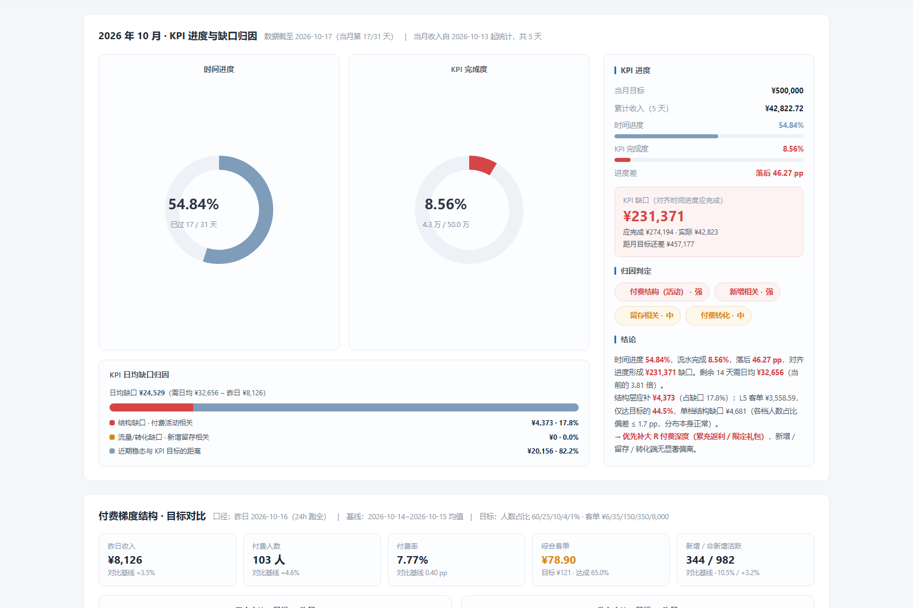
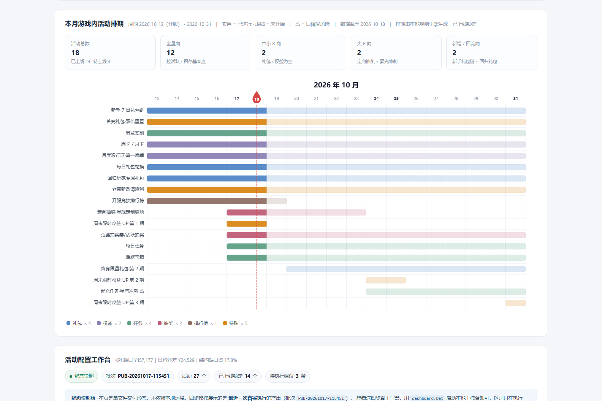
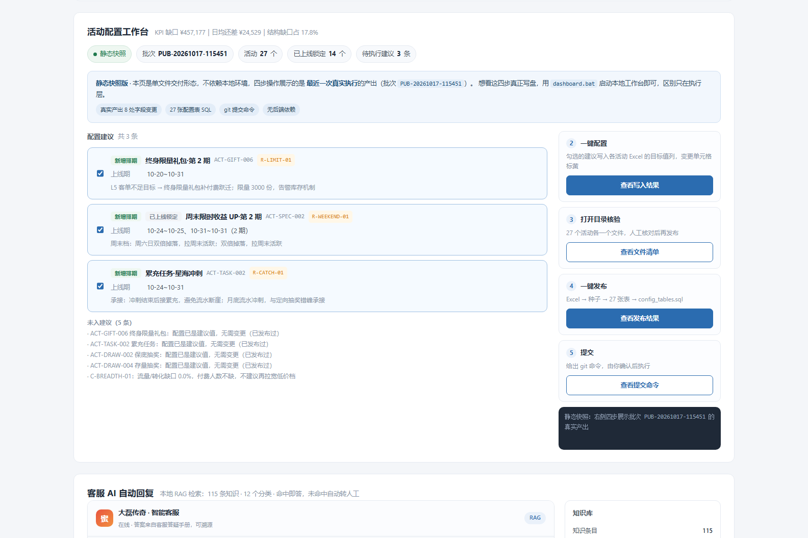
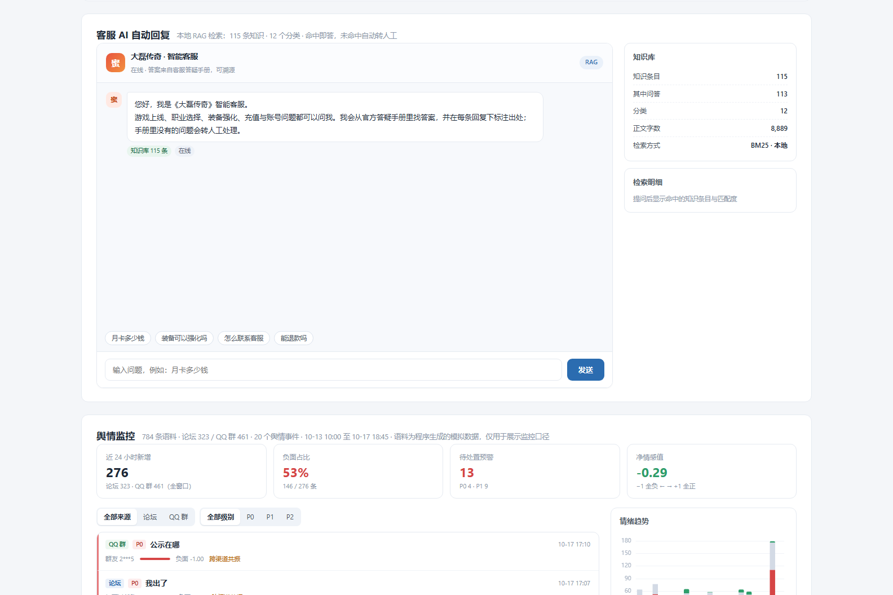
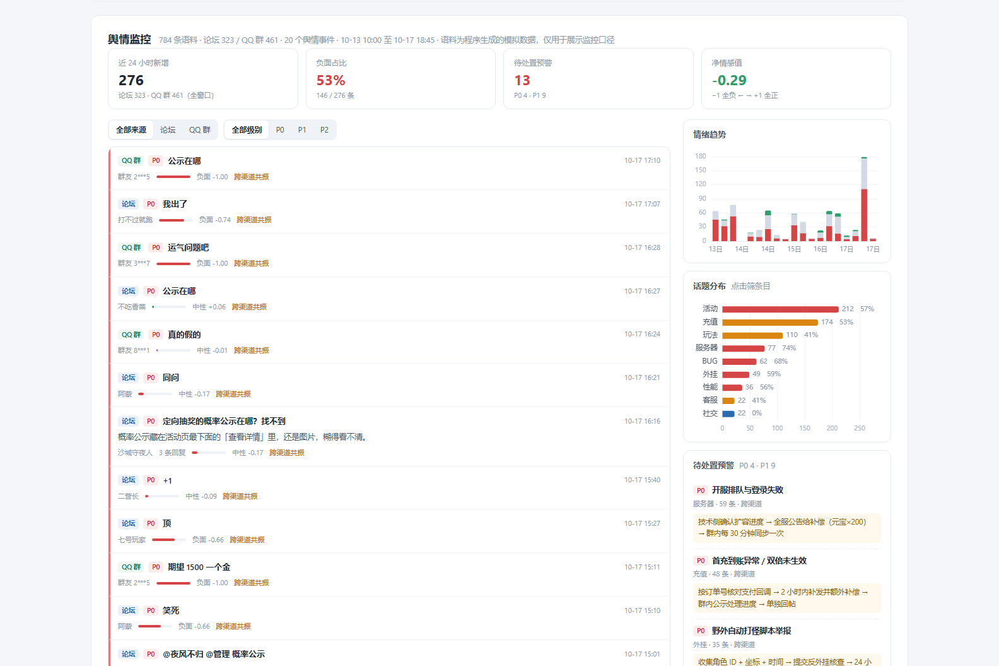
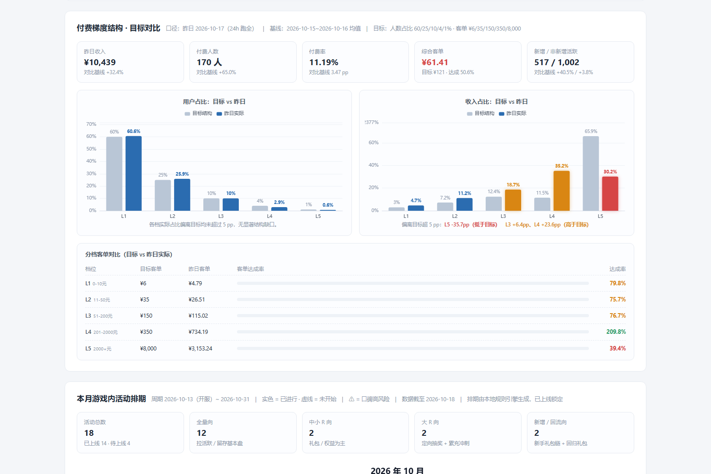

# 大磊传奇 · 游戏运营技能展示作品集

> 自己的一套运营经验和方法论的内化，仅展示了一些核心执行模块，全文基于workbuddy生成。
>
> 所有数据均为程序模拟，不含任何真实业务数据；本项目为个人作品集，用于展示数据驱动运营的方法论与工程落地能力。

---

## 在线预览（无需安装任何东西）

**👉 [点这里打开数据看板](https://htmlpreview.github.io/?https://github.com/Lex3300/game-ops-portfolio/blob/main/index.html)**

看板是单文件 HTML（1.4 MB），首次加载约需十几秒；看板里六个区块可直接交互（筛选、提问、展开明细）。

> 加载慢或打不开时，可 [下载 `index.html`](https://github.com/Lex3300/game-ops-portfolio/raw/main/index.html) 后双击本地打开，效果完全一致。

---

## 一、我的思路：为什么做"闭环"，而不是五个独立工具

大多数运营的日常工作被切成四段：**看数据 → 找问题 → 上活动 → 看效果**。段与段之间靠人肉衔接：报表看完写结论，结论放进周报，活动另起一张表，效果能不能归因全看运气。

这个项目把整条链**串成一条可验证的闭环**：

```
   ① 数据生成          ② 看板诊断           ③ 活动干预
   每日模拟数据   ──►   发现 KPI 缺口   ──►   排期引擎 + 配置工作台
      ▲                                  把缺口翻译成活动配置
      │                                        │
   ⑥ 舆情预警   ◄──  ⑤ 客服 RAG   ◄──  ④ 效果回流
   玩家在说什么      拦截重复咨询      活动真的改写数据分布
```

支撑这条闭环成立的是三个设计决定：

**1. 数据必须有"剧本"。** 纯随机数据是噪声，曲线没有解释、干预无法归因。所以生成器内置三层剧本参数——基线（正常曲线 + 周末效应）、拐点（预设问题现场，如第 30 天起七留下滑 40%）、干预（活动上线后改写参数，后续数据随之变化）。这让**每一次活动干预都能在看板上看到拐点**：能被验证的干预才算干预。

**2. 建议必须能落成配置。** 只输出一句"建议上充值返利"不是能力，把缺口翻译成可执行、可发布、可回溯的配置才是。区块04 的配置工作台走完四步真实流程：建议 → 写入 Excel → 人工核验 → 发布为 SQL（配置即代码），每次发布落变更日志。

**3. 每个自动化都要有兜底。** 客服 RAG 查不到就明确回复"请等待人工介入"而不是编答案；舆情只做分析口径演示、语料全部标注模拟；排期引擎对已上线活动强制锁定、只增改未上线。**知道系统的边界，和知道它能做什么同样重要。**

---

## 二、内容导览（六个模块）

| # | 模块 | 目录 | 证明的能力 |
|---|------|------|-----------|
| ① | 虚拟数据库 | [`01_datagen/`](01_datagen/README.md) | 数据建模：日粒度模拟引擎，带剧本参数，附一致性巡检视图 |
| ② | 数据看板 | [`02_dashboard/`](02_dashboard/) | 用数据讲清楚问题：KPI 归因、付费结构、排期甘特、客服对话、舆情预警 |
| ③ | 活动 Agent | [`03_activity_agent/`](03_activity_agent/README.md) | 从诊断到落地的完整链路：27 活动 × 27 张独立配置表，排期引擎 + Excel 配置工作台 + 配置即代码 |
| ④ | 活动知识库 | [`04_knowledge/`](04_knowledge/README.md) | （下一阶段）症状-病因-处方矩阵，趋势分析自动匹配活动打法 |
| ⑤ | 客服 RAG | [`05_cs_rag/`](05_cs_rag/README.md) | 零依赖检索工程：本地 BM25 + 同义词归一 + 置信度四道闸，可溯源、敢兜底 |
| ⑥ | 舆情监控 | [`06_sentiment/`](06_sentiment/README.md) | 分析口径设计：论坛 + QQ 群双渠道，P0/P1 分级预警与处置动作 |

### 看板实际效果

**区块01 · KPI 诊断** —— 唯一结论区：不堆指标，直接给出进度差、归因判定（付费结构问题·强）和下一步行动建议。



**区块03 · 活动排期** —— 27 个活动的甘特视图，已上线活动锁定，与排期台账比对后的增改结果一目了然。



**区块04 · 配置工作台** —— 把"建议"变成"配置"的四步闭环：一键配置写入 Excel → 打开目录人工核验 → 一键发布为 SQL → 生成 git 提交命令。下图是单文件版对最近一次真实发布（批次 PUB-20261017-115451）的静态回放。



**区块05 · 客服 AI 自动回复** —— 基于《客服答疑手册》115 个知识块的本地 RAG 对话，命中给出处与匹配度，查不到明确转人工。



**区块06 · 舆情监控** —— 论坛 + QQ 群双渠道舆情流：P0 红边置顶、情绪趋势堆叠柱、话题榜、待处置预警，图表与列表联动筛选。



**区块02 · 付费结构** —— 付费档位分布与目标对比、流水缺口的档位级拆解。



---

## 三、建议阅读路线

**只有 3 分钟**：看本页 + [在线预览](https://htmlpreview.github.io/?https://github.com/Lex3300/game-ops-portfolio/blob/main/index.html)里的区块01（诊断结论）和区块04（配置闭环），这两处最能体现"从数据到行动"。

**有 15 分钟**：按 ①→③ 顺序读三个模块的 README——`01_datagen`（数据怎么来的、为什么可信）→ `03_activity_agent`（诊断怎么变成配置）→ `05_cs_rag`（无模型无网络时检索怎么做）。

**想动手验证**：克隆仓库后双击 `start.bat` 生成数据、双击 `dashboard.bat` 打开本地版看板（区块04 的写盘按钮可用），详见 [docs/运行说明.md](docs/运行说明.md)。

---

## 四、目录结构

```
game-ops-portfolio/
├─ README.md               # 本文件：思路 + 内容导览
├─ index.html              # 单文件看板（在线预览 / 双击即看 / 可单独分发）
├─ start.bat               # 一键：生成 / 增量追加数据
├─ dashboard.bat           # 一键：跑引擎 → 重建看板数据 → 启动本地服务
├─ export.bat              # 一键：数据库导出 CSV / Excel
├─ data/
│  ├─ game.db              # SQLite 主库（唯一数据源，首次运行自动生成，不入库）
│  └─ export/              # 导出产物（随时可重跑）
├─ 01_datagen/             # ① 库结构 + 模拟引擎 + 剧本配置
├─ 02_dashboard/           # ② 看板源码（index.html 拆分版）+ 打包脚本
├─ 03_activity_agent/      # ③ 排期引擎 + 27 张配置表 + Excel 配置工作台
├─ 04_knowledge/           # ④ 活动知识库（下一阶段）
├─ 05_cs_rag/              # ⑤ 客服知识库 + BM25 检索
├─ 06_sentiment/           # ⑥ 舆情语料生成器 + 分析口径
└─ docs/                   # 截图、运行说明等支撑文档
```

---

## 五、技术栈

| 层 | 选型 | 一句话理由 |
|---|------|-----------|
| 存储 | SQLite | 单文件零部署，面试官可用任意工具直接打开核对 |
| 数据生成 | Python（纯标准库） | 剧本参数驱动的日粒度模拟，规则全透明可复现 |
| 看板 | HTML + ECharts，单文件交付 | 静态页面加载快、不依赖后端存活，演示场景最可靠 |
| 配置载体 | Excel（openpyxl） | 运营的真实工作界面是 Excel，不是数据库 |
| 检索 | 本地 BM25 + 同义词归一 | 无模型、无网络约束下的可溯源问答 |

---

## 六、边界与声明

- 所有玩家数据、活动数据、舆情语料均为**程序模拟**，已在页面与文档中明确标注，与任何真实产品无关。
- 舆情模块不做真实采集，演示的是"接入真数据后这套分析口径怎么跑"。
- 活动知识库内容整理自个人经验总结。
- 仓库不含数据库与导出产物（见 `.gitignore`），克隆后按 [docs/运行说明.md](docs/运行说明.md) 一键复现。
